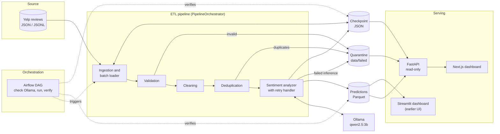

# SelfHealingPipeline

**An AI-Powered Self-Healing ETL Pipeline for Large-Scale Review Sentiment Analytics**

SelfHealingPipeline turns raw, unstructured customer reviews into structured sentiment analytics. It reads the Yelp review dataset in bounded batches, validates and cleans each record, removes duplicates, and classifies sentiment with a locally hosted language model served by Ollama. Predictions are stored as Parquet and explored through a read-only FastAPI service and a Next.js dashboard. Apache Airflow can schedule and verify runs.

The pipeline is built to survive interruption. Progress is checkpointed per batch, transient inference errors are retried with exponential backoff, and records that cannot be processed are quarantined to disk instead of stopping the run. It is a working system with documented gaps, not a production-hardened service; the [limitations](#known-limitations) are listed explicitly.

## The Problem

Review data is large and messy, and sentiment inference with a local LLM is slow and fallible. A realistic workload has to deal with:

- **Scale.** The Yelp review file is several gigabytes of JSON Lines. It cannot be loaded into memory at once.
- **Malformed and incomplete records.** Missing IDs, ratings outside 1–5, empty text and unparseable dates appear in real data.
- **Duplicates.** The same review ID can appear more than once.
- **Slow, unreliable inference.** A local model processes reviews one at a time, can time out, can be unreachable, can be missing, and can return malformed output.
- **Interruption.** A run over many batches takes long enough that it will be stopped, crash, or lose its model server partway through.
- **Exploration.** Results are only useful if analysts can filter, search and inspect individual predictions.

A one-shot script that reads everything, loops over it and writes a single output fails badly here. One bad record or a dropped model connection discards all progress, nothing explains what was rejected, and a restart begins from zero. The design below addresses each of those weaknesses, with the caveats noted later.

## System Architecture

**Layers and responsibilities**

- **Ingestion** (`src/ingestion`): detects the file format, streams JSON Lines instead of loading the file, and hands out fixed-size batches starting from the first uncompleted batch.
- **Processing** (`src/processing`): validates required fields, rating range, text and date; normalizes review text; removes duplicate review IDs.
- **Inference** (`src/inference`): builds the prompt, calls Ollama, parses and validates the structured response, and wraps calls in the retry handler.
- **Recovery** (`src/recovery`): the checkpoint manager and the retry handler.
- **Orchestrator** (`src/pipeline.py`): runs the stages for each batch in order, writes outputs and quarantine files, and records progress.
- **Airflow** (`dags/`): a daily DAG that checks Ollama, runs the pipeline and verifies that outputs and checkpoints exist.
- **API** (`api/`): a read-only FastAPI service that aggregates predictions, checkpoints and quarantine files for the dashboard.
- **Dashboard** (`frontend/`): a Next.js application with Overview, Reviews and Pipeline pages. An earlier Streamlit dashboard is still in the repository and runs under Docker Compose.

## End-to-End Data Flow

1. **Discovery and reading.** The pipeline finds raw files matching its configured patterns and reads them incrementally. JSON Lines files are streamed.
2. **Batching.** Records are grouped into bounded batches with a configurable size. Batches already recorded in the checkpoint are skipped.
3. **Validation.** Each record must have a review ID, business ID, rating between 1 and 5, non-empty text and a parseable date. Failures are written to `data/failed` with their error messages.
4. **Cleaning.** Review text is normalized. The original text is kept next to the cleaned text.
5. **Deduplication.** Records whose review ID has been seen before, within the batch or earlier in the same run, are removed and written to quarantine.
6. **Inference.** Each remaining review is sent to the local model through Ollama.
7. **Extraction.** The model returns sentiment, a confidence value, positive and negative aspects and short reasoning.
8. **Persistence.** Predictions are written as one Parquet file per batch, together with the original and cleaned text and model metadata.
9. **Checkpoint.** After a batch finishes, the checkpoint records its status and counts.
10. **Serving.** FastAPI reads the Parquet files, checkpoint and quarantine files and exposes filtered, paginated and aggregated views.
11. **Visualization.** The Next.js dashboard renders sentiment trends, distribution, drivers, a searchable review table and pipeline health.

## AI Sentiment Analysis

**Why Ollama.** Reviews are processed locally. No review text leaves the machine, there is no per-request cost, and the model is swappable through configuration.

**Why Qwen 2.5 3B.** The default model is `qwen2.5:3b`, small enough to run on modest hardware while still able to follow a structured-output instruction. The model name is configurable.

**Structured output.** The prompt asks for a JSON object, and the client requests JSON-formatted output from Ollama. The response is parsed and validated against a schema before it is accepted:

- `sentiment`: one of `positive`, `negative`, `neutral`
- `confidence`: a number from 0 to 1
- positive and negative aspects: short phrases taken from the review
- reasoning: a brief explanation

**Confidence is not calibrated.** The value is reported by the model about its own answer. It is useful for ordering and spotting uncertain predictions, but it should not be read as a probability of being correct. In the stored data it clusters near 0.9 to 1.0. There is no human-labelled ground truth in the pipeline, so accuracy is not measured.

**Aspects are free text.** Aspect phrases are not normalized, so most appear once. Counts become informative only over larger volumes or with normalization.

**Failure handling.** Connection errors and timeouts are treated as transient and retried with exponential backoff. A malformed model response is treated as non-retryable. A review that still cannot be classified is written to quarantine as a failed inference rather than guessed.

## Reliability and Recovery Design

**Implemented**

- **Batch-level checkpoints.** The checkpoint records each completed batch with its status, record counts, source file and timestamp. On restart the pipeline resumes after the last recorded batch of a source file.
- **Atomic checkpoint updates.** The checkpoint is written to a temporary file in the same directory, flushed to disk and renamed over the previous file, so a crash during a write does not leave a half-written checkpoint. A corrupted checkpoint is moved aside, and a backup is kept.
- **Retry handling.** Transient errors are retried with a configurable number of attempts and backoff factor. Non-retryable errors fail immediately.
- **Quarantine.** Invalid records, duplicates and failed inferences are written to per-batch JSON files with the reason, so nothing is dropped silently.
- **Orchestration checks.** The Airflow DAG checks that Ollama is reachable before running and verifies afterwards that prediction files and a checkpoint exist.

**Idempotency.** Prediction files are named by source file and batch number, so reprocessing a batch overwrites its own file rather than adding a second copy. Deduplication state is held in memory for the duration of a run and is not persisted, so duplicates that span separate runs are not detected by the pipeline itself. The API keeps the latest prediction per review ID when reading.

### Known limitations

These were found during the final audit and are intentionally not fixed here.

- **No replay of failed inferences.** Records in quarantine are not re-queued automatically. Recovery of those records requires a later run that happens to process them again. In the audited data set, 15 of 78,157 logged failed records had a later prediction.
- **Batches complete despite inference failures.** A batch is recorded as completed even when every inference in it failed. In the audited data most inference failures occurred because the configured model was not installed at the time. The checkpoint therefore shows progress, not success.
- **Airflow verification is shallow.** It checks that outputs and a checkpoint exist. It does not fail the run when most inferences have failed.
- **Retry attempts are not persisted** as structured data, and inference latency is not recorded, so the dashboard cannot show either.
- **No analytics output.** The pipeline does not write aggregate files to its analytics directory. The API computes aggregates when asked.
- **Re-running a completed source file starts a fresh cycle** for that file instead of doing nothing.
- **Test coverage** covers the Python pipeline, inference client, recovery and Streamlit dashboard. The FastAPI service and Next.js frontend have no automated tests.

## Technology Stack

| Responsibility | Technology |
|---|---|
| Language and processing | Python, pandas, NumPy, Pydantic, python-dotenv |
| AI inference | Ollama, Qwen 2.5 3B |
| Orchestration | Apache Airflow with LocalExecutor |
| Storage | Parquet (PyArrow), JSON checkpoints and quarantine files, PostgreSQL for Airflow metadata |
| Backend API | FastAPI, Uvicorn, httpx |
| Frontend and visualization | Next.js (App Router), TypeScript, Tailwind CSS, Recharts, Lucide; Streamlit and Plotly for the earlier dashboard |
| Containerization and testing | Docker Compose, pytest |

## Dashboard

The dashboard reads real pipeline output. The figures below come from a development dataset in which most inferences failed because the model was missing during an earlier run, which is why the Pipeline page shows a large failure count.

**Overview.** Headline sentiment metrics, a sentiment trend with a date-range selector, sentiment distribution, top positive and negative drivers and recent pipeline activity.

**Reviews.** Search and filter predictions, sort columns, and open any review to see its original and cleaned text, confidence, aspects and the model's reasoning.

**Pipeline.** Pipeline status, record flow through each stage, retry and recovery counts, Ollama health, the latest checkpoint and recent batches. Values the pipeline does not record are marked as unavailable rather than estimated.

## Repository Notes

- Configuration is read from environment variables; `.env.example` lists the available settings and `.env` is ignored by Git.
- Raw data, predictions, checkpoints, quarantine files and logs are generated at runtime and are not committed.
- The Airflow admin and PostgreSQL credentials in the Compose file default to local-development values and should be changed before exposing any port. The Airflow Fernet key must be supplied by the user.
