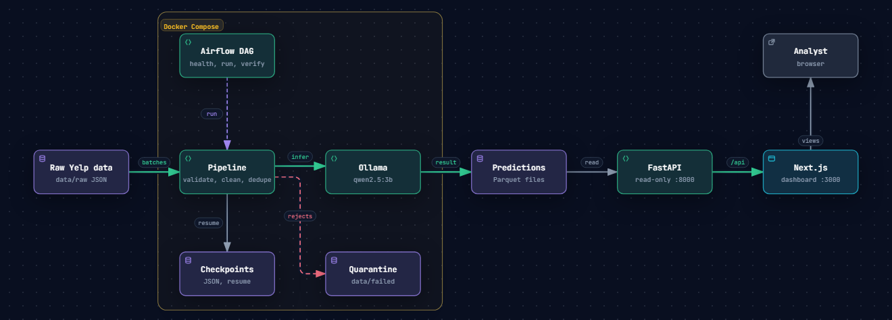
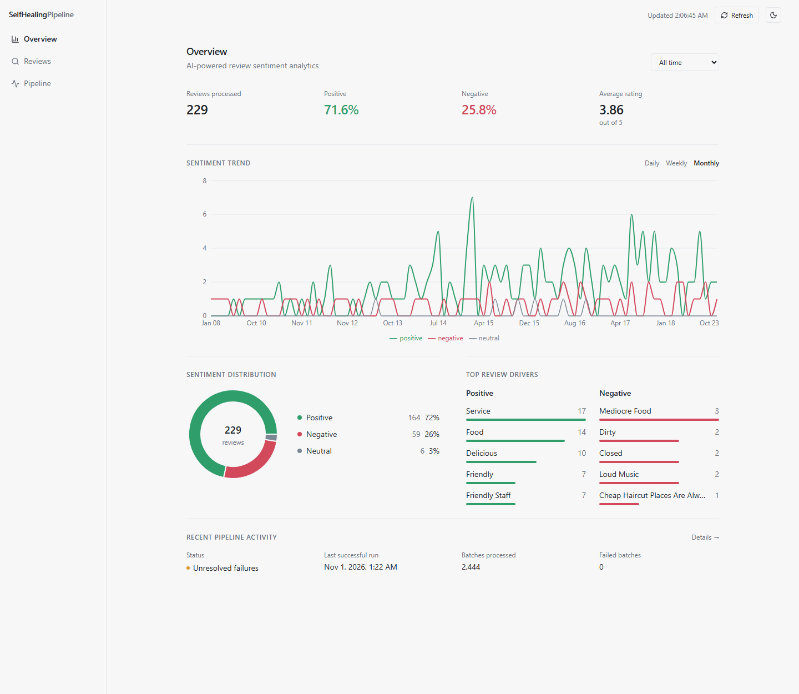
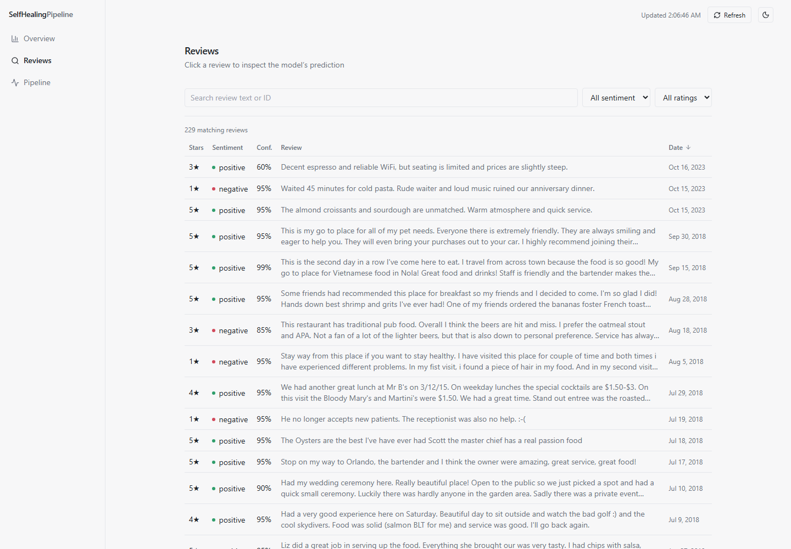
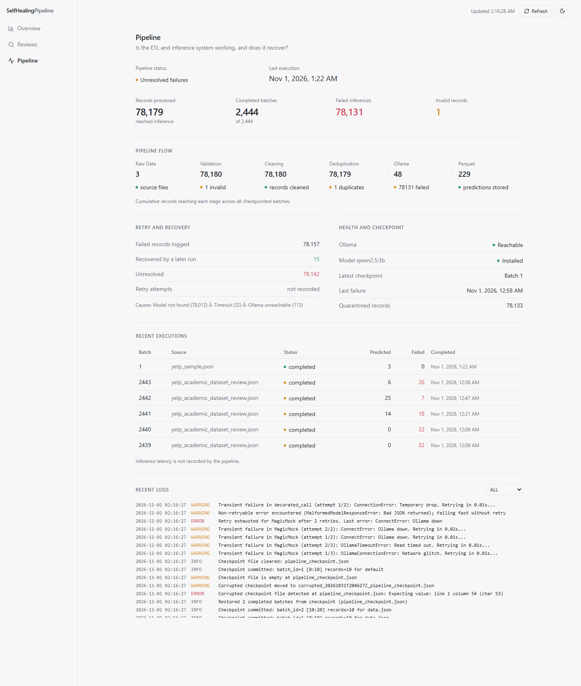

# SelfHealingPipeline

**An AI-Powered Self-Healing ETL Pipeline for Large-Scale Review Sentiment Analytics**

SelfHealingPipeline reads large sets of customer reviews, cleans them, and classifies the sentiment of each review with a local language model. Results are stored as Parquet and explored in a Next.js dashboard. Airflow can schedule the runs.

## What it does

- Reads the Yelp review dataset in small batches, so large JSON files never have to fit in memory.
- Validates each record (IDs, 1–5 rating, text, date) and sets invalid ones aside.
- Cleans review text and removes duplicate reviews.
- Sends each review to a local model (Qwen 2.5 3B through Ollama) that returns sentiment, a confidence score, positive and negative aspects, and a short reasoning.
- Saves predictions as Parquet files, one per batch.
- Saves a checkpoint after every batch so a run can resume where it stopped.
- Retries temporary inference errors with exponential backoff and writes records it cannot process to a quarantine folder.
- Serves the results through a read-only FastAPI service to the dashboard.

## Architecture

| Layer | Role |
|---|---|
| Ingestion | Detects the file format, streams JSON Lines and hands out batches |
| Processing | Validation, text cleaning and deduplication |
| Inference | Prompts Ollama and validates the structured response |
| Recovery | Atomic JSON checkpoints and the retry handler |
| Orchestrator | Runs the stages for each batch and writes outputs |
| Airflow | Daily DAG: check Ollama, run the pipeline, verify outputs |
| FastAPI | Read-only API over predictions, checkpoints and quarantine files |
| Next.js | Dashboard with Overview, Reviews and Pipeline pages |

## Data flow

1. Raw files are discovered and read incrementally.
2. Records are grouped into batches.
3. Invalid records are quarantined with the reason.
4. Review text is normalized.
5. Duplicates are removed.
6. Remaining reviews go to the local model.
7. Sentiment (positive, negative or neutral), confidence and aspects are extracted.
8. Predictions are written to Parquet and the checkpoint is updated.
9. FastAPI exposes the data and Next.js visualizes it.

Confidence is reported by the model itself and is not a calibrated probability.

## Dashboard

**Overview** – sentiment metrics, trend over time with a date-range selector, distribution and the top positive and negative drivers.

**Reviews** – search, filter and sort predictions, and open any review to see its text, confidence, aspects and reasoning.

**Pipeline** – status, record flow through each stage, retry and recovery counts, Ollama health, recent batches and logs.

